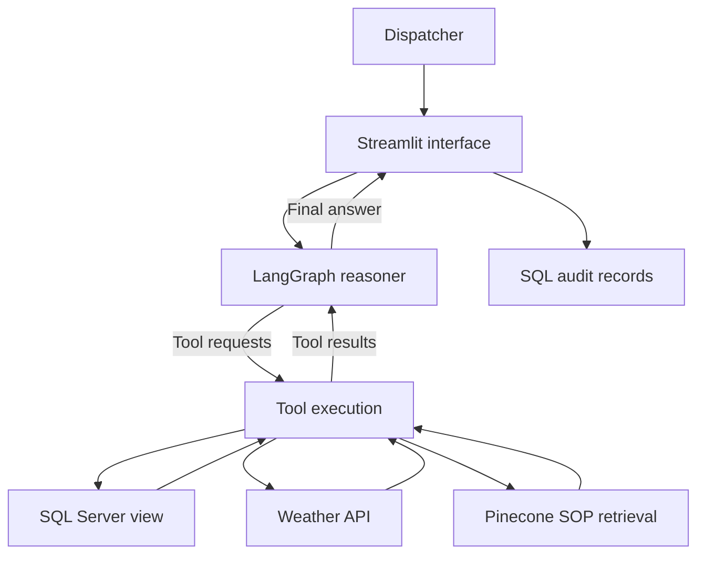
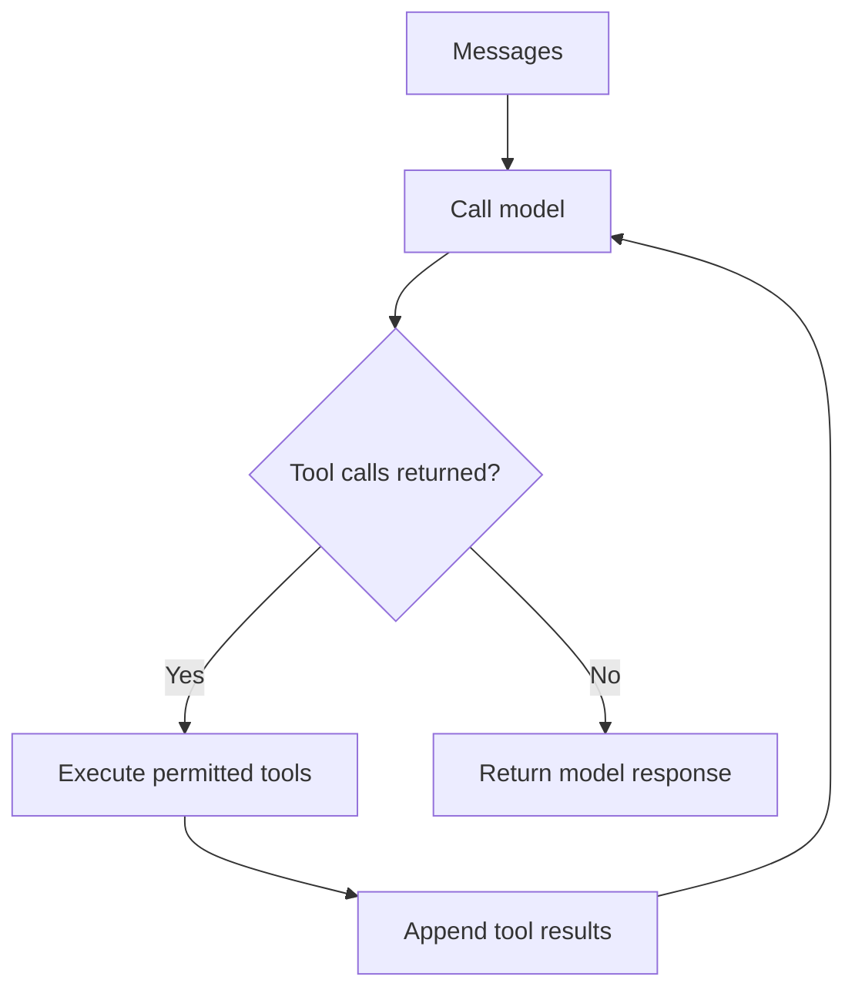

# Architecture you should be able to explain

## Business goal

A dispatcher needs to combine recorded cargo conditions with operational policy and environmental context. A natural-language interface can reduce the effort of looking across systems. The desired output is evidence-backed decision support. Success should be measured with representative dispatcher tasks, not whether a chat screen produces plausible prose.

## Original implementation

This is a logical component diagram. In the source, Streamlit imports the Python orchestrator; there is no separate orchestrator API service. MemorySaver holds graph state in the app process. The design document describes tiers more strongly than the actual process separation delivers.

## The agent's branch

LangGraph controls execution and state. The language model proposes the tool and its arguments. Python implements the tool. The database and network permissions determine what the tool can actually access. A model-generated instruction is not an authorisation grant.

Tools do not transmit a model's hidden internal reasoning. The application can record observable messages, tool names, arguments, outputs and final responses.

## Why three data sources?

| Data need | Mechanism | Important limit |
|---|---|---|
| Temperatures and coordinates | SQL SELECT against a view | Historical rows are not automatically live telemetry |
| Environmental conditions | Weather API | Current weather may not match the timestamp of the stored shipment observation |
| Written company procedures | Chunking, embeddings and vector retrieval | A similar chunk may still be the wrong rule or version |

An embedding converts text to numbers used for similarity search. It does not confirm truth. RAG supplies retrieved source text to the model; it is not training a model on your documents. An agent may decide when to use retrieval and other tools.

## Teaching lab versus original stack

| Component | Offline companion | Original project |
|---|---|---|
| Data | Five synthetic records in SQLite | CSV ingested to SQL Server |
| Querying | Fixed parameterised function | Model-generated T-SQL passed to a tool |
| Policy search | Visible keyword overlap | Embeddings and Pinecone |
| Reasoning | Deterministic rules | LLM with LangGraph tool loop |
| Weather | Explicitly disconnected | Live Open-Meteo call plus a demo wind heuristic |
| UI | Terminal JSON | Streamlit |
| Trace | Local JSONL | SQL audit table from the UI |
| Purpose | Learn contracts, evidence, tests and failure modes | Learn how these pieces connect to an AI model |

## Azure mapping

These are candidate design choices, not deployed resources or one-click equivalents.

| Original choice | Possible Azure approach | What must change |
|---|---|---|
| App on EC2 | Azure VM first, or a container on Container Apps | Packaging, ingress, secrets and health checks |
| SQL Server in Docker | Local Developer edition for learning; assess Azure SQL for a managed deployment | Connection settings, database naming, authentication and migration compatibility |
| OpenAI direct endpoint | An approved model deployment in Azure | Client configuration, deployment name, API version/auth and quota |
| Pinecone | Keep Pinecone, or assess Azure AI Search vector/hybrid retrieval | Index schema, ingestion, retrieval adapter and cost profile |
| Local `.env` | Managed identity and Key Vault where supported | Remove secrets from application files and separate identities |
| SQL audit table | Structured application logs plus controlled retention | Correlation IDs, privacy controls, access, alerts and failure handling |
| SSH deployment action | Build/test pipeline with a controlled release | Reproducible dependencies, immutable artefact, approvals and rollback |

Do the local lessons first. Decide on Azure services only after you can describe the required capability. Substituting service names does not establish security, reliability or interoperability.

## Design questions for your architect practice

1. Which questions require the most recent reading per shipment? What key identifies a shipment?
2. Can the model answer a policy-only question without requesting shipment data?
3. Should the model write arbitrary SQL, use approved query templates, or call narrower functions?
4. What happens if retrieval fails but the model continues confidently?
5. When do you require a human decision? How will it be represented in application state?
6. What is the maximum acceptable latency and model cost per successful case?
7. Which source versions and timestamps let you reproduce an answer later?
