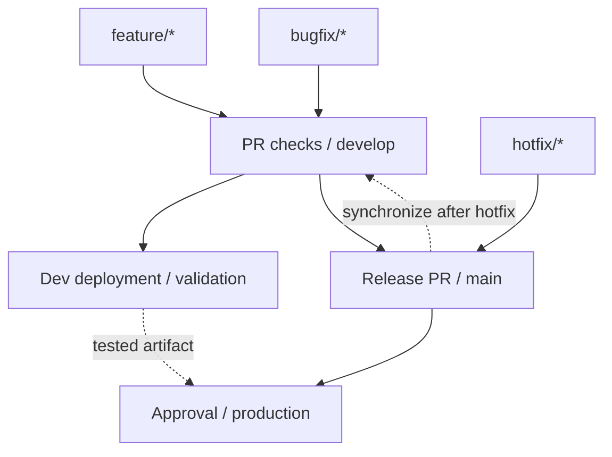

# Branches, dev deployments and production releases

This is our chosen training workflow. It deliberately includes a shared `develop` branch and a separate release branch, `main`, so you can practise integration and promotion. Teams also use main-only workflows; branch names do not create deployment environments.

**Current implementation:** the offline checks workflow exists. This extension adds documentation, templates and branch conventions. Cloud deployment jobs, environment approval rules, branch protection and infrastructure are not configured by these files. The initial foundation PR targets `develop`; `main` stays at the previously published version until a release PR is merged.

## Branch responsibilities

| Branch | Start from | PR target | Purpose |
|---|---|---|---|
| `feature/short-description` | Latest `develop` | `develop` | One new capability with its checks |
| `bugfix/short-description` | Latest `develop` | `develop` | A normal defect fix with a regression test |
| `develop` | Initially copied from `main` | `main` for a release | Integrate completed changes; intended dev deployment source |
| `main` | Release PR from `develop`, or reviewed hotfix | Back to `develop` when needed | Record released source; intended production release source |
| `hotfix/short-description` | Released `main` | `main`, then synchronize `main` into `develop` | Repair a production defect without including unfinished development |



The main-branch PR and the successful dev deployment are both release prerequisites. A PR merge is not proof of a successful deployment. The hotfix path still needs candidate testing before production; it does not bypass artifact validation.

## One normal change, step by step

1. Write the requirement or defect and observable acceptance criteria. Use the issue templates if useful.
2. Fetch the latest code and create a short-lived branch:

```bash
git fetch origin
git switch -c feature/shipment-status-api origin/develop
```

3. Implement the focused change. Inspect `git diff`, run the relevant checks and stage the intended paths.
4. Inspect `git diff --cached`, then commit and push:

```bash
git commit -m "feat: expose shipment assessment through HTTP"
git push -u origin HEAD
```

5. Open a PR whose base is `develop`. Review the files and check results. For a bug fix, attach the failing-before/passing-after regression evidence.
6. Resolve feedback and conflicts on your working branch. Review changed conflict resolutions and rerun affected checks. Do not resolve by blindly choosing an entire side.
7. Squash-merge an individual feature/bug-fix PR after review and checks. This gives the integrated change one identifiable commit. Delete the working branch after verifying the merge.
8. Fetch the merged development code. The future dev workflow builds and deploys from the integrated `develop` commit; the current checks workflow only runs tests and documentation validation.

Keep unfinished edits out of branch switches. For this beginner route, merging `origin/develop` into a working branch is sufficient when it falls behind. We can practise interactive rebase later on a branch you own, with an explanation of how it rewrites commits.

## Configure protections as an exercise

Before connecting deployment jobs, use GitHub's repository settings to configure rules for `develop` and `main`: pull requests, the passing offline check, resolved conversations and restricted force pushes/deletions. Add new required checks only after their workflows exist and have run successfully. Verify the actual check name in the PR instead of guessing it.

For this solo learning repo, requiring an approval from another person would block your own PRs until you add a reviewer: authors cannot approve their own PR. Begin with mandatory PRs and successful checks, and document your manual diff review. Add a real second reviewer when practising independent review. An AI-generated review comment is not independent human approval.

For GitHub deployment environments, the planned settings are:

| Environment | Allowed deployment ref | Configuration | Gate |
|---|---|---|---|
| `dev` | `develop` | Dev identity, endpoints, synthetic data and secrets | Successful build and automated checks |
| `production` | `main` | Separate production identity, endpoints and secrets | Verified candidate plus explicit environment approval |

These are settings we must create and inspect in GitHub; declaring `environment: production` in YAML alone does not establish all of them. For a solo learning deployment, a manual approval by the learner is a deliberate release checkpoint. Enable prevention of self-review only when a second eligible person can review. Public-repository features and private-repository plans differ; recheck availability if this repo's visibility or plan changes.

See [GitHub deployment environments](https://docs.github.com/en/actions/reference/workflows-and-actions/deployments-and-environments). The initial branch inventory showed `main` was unprotected; this guide does not claim those controls are already enforced.

## Build once, promote the tested artifact

This is the release design to implement in D6-D8. Documentation-only changes can be promoted after their normal review/checks without inventing an image build or a deployment; artifact-promotion checks apply when releasing the deployable application.

1. After a change reaches `develop`, build the image once from that source. Record the full source commit, Git tree ID, image digest and build run. A commit tag is a useful label; the digest identifies the exact image bytes.
2. Deploy that digest to dev. Run health and behaviour checks against the deployed service. A healthy process alone does not prove that shipment answers are correct.
3. Record successful dev validation against that digest and configuration version. Use a trusted workflow artifact/release record, not a digest supplied only in untrusted PR text.
4. During this training release, pause further merges into `develop` while the selected candidate is being promoted. If its contents change, validate a new candidate. A dedicated release branch is a later option for parallel development.
5. Open a release PR from `develop` to `main`, attaching the candidate evidence. **Use a merge commit** for the release PR, preserving the ancestry of the shared branches.
6. The production job verifies that the released source tree matches the dev-tested candidate, its CI/dev run succeeded and its image belongs to the expected registry/repository. A release merge has a new commit SHA even when the file tree is identical; record both the source commit and release merge commit.
7. After the environment gate, deploy the **same image digest** with production configuration. Do not rebuild it in the production job or resolve a moving `latest` tag. Verify and record the resulting deployment.
8. Use an environment-specific deployment concurrency group so two releases cannot overwrite one another. Do not cancel an in-progress production change midway as a substitute for rollback.

Feature PRs can use squash merges. Release PRs and synchronization between the long-lived branches should preserve their history with merge commits. If a hotfix has put `main` ahead, merge it into `develop`, resolve conflicts and test before preparing the next normal release.

## Azure access and environment separation

Use a distinct deployment identity for each environment, scoped to the necessary resources. Configure GitHub-to-Azure OIDC federation and grant `id-token: write` only to jobs that need token exchange. This permission allows token issuance; Azure RBAC still decides which resources may be changed. Keep provider API keys in the selected runtime secret mechanism.

Check the repository's actual OIDC subject-claim format before creating its federated credential. Current GitHub guidance changes the default subject format for new repositories after 15 July 2026. Do not assume an old name-based `repo:owner/name:environment:...` example matches this repo's settings. Bind the exact intended repository/environment claims and test an unauthorized branch as well as a permitted one.

For this lab, create separate dev and production resource groups, apps, runtime identities and data settings. Sharing a registry can be an explicit cost choice, but it does not imply sharing runtime credentials or data. The runtime identity should not be able to deploy infrastructure. Recheck configuration, network ingress and secrets before enabling the model-backed service.

See [GitHub OIDC with Azure](https://docs.github.com/en/actions/how-tos/secure-your-work/security-harden-deployments/oidc-in-azure). We will review the exact Bicep resources and an estimate before the cloud exercise; there is no deployable Azure workflow in this foundation PR.

## Rollback and hotfix are different exercises

**Rollback** restores a previous known working artifact/configuration so service can recover. Record the previous digest before a release, restore it through the controlled workflow and run the same smoke checks. Database migrations and policy/index changes may need their own compatible recovery plan; restoring an image alone cannot undo data changes.

**Hotfix** creates a new corrected version. For a production defect:

1. Reproduce against the released version and create `hotfix/describe-defect` from `origin/main`.
2. Add a failing regression test, make the fix and test the candidate image in an isolated validation environment. Avoid overwriting shared dev when it contains unrelated development.
3. Review the hotfix PR into `main`; approve and deploy the validated digest using the production gate.
4. Open a synchronization PR from `main` into `develop`, use a merge commit, resolve conflicts and rerun checks. Verify the regression test is present on develop.

A later `git revert` can remove an unwanted source change through a new reviewed commit. It creates a different artifact; distinguish it from redeploying the previous image.

## Who does what

| Participant | Responsibility |
|---|---|
| You | Define expected behaviour, understand the diff, exercise the result and make the learning release decision |
| Coding agent | Help inspect sources, implement scoped edits, reproduce defects, run checks and prepare evidence |
| GitHub Actions | Execute the checked-in test/build/deployment jobs under configured permissions |
| Shipment agent | Use its allowed data/policy tools and explain operational evidence |

The coding agent can help prepare release inputs and read deployment results. It is not the production gate, and the shipment agent is not a CI runner. Every completed release should be reproducible from its recorded source, artifact and configuration.

Return to [the delivery units](DELIVERY_PATH.md) or [your checkpoint](../progress/LEARNING_TRACKER.md).
